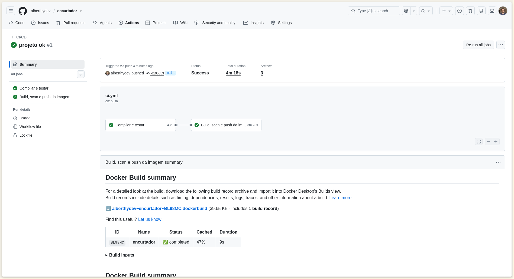
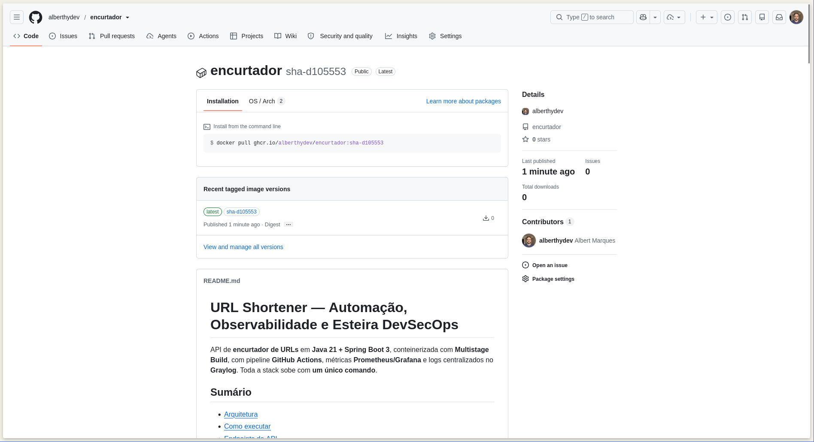
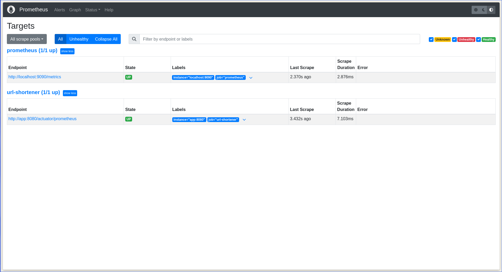
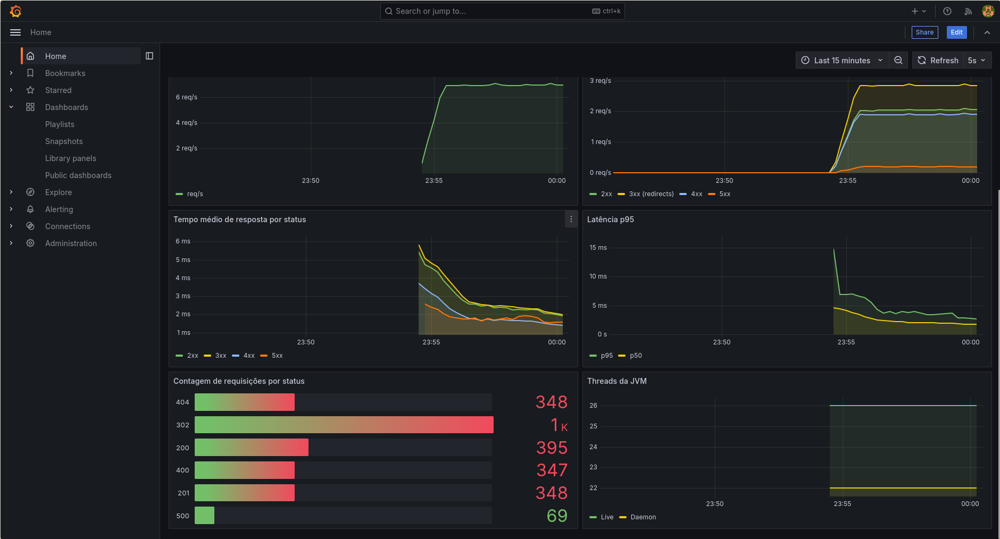
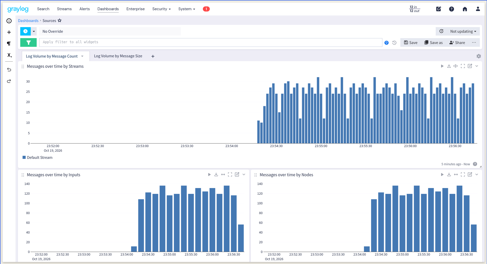

# URL Shortener — Automação, Observabilidade e Esteira DevSecOps

API de **encurtador de URLs** em **Java 21 + Spring Boot 3**, conteinerizada com **Multistage Build**, com pipeline **GitHub Actions**, métricas **Prometheus/Grafana** e logs centralizados no **Graylog**. Toda a stack sobe com **um único comando**.

## Sumário
- [Arquitetura](#arquitetura)
- [Como executar](#como-executar)
- [Endpoints da API](#endpoints-da-api)
- [Observabilidade](#observabilidade)
- [Pipeline CI/CD](#pipeline-cicd)
- [Decisões técnicas](#decisões-técnicas)
- [Evidências](#evidências)
- [Solução de problemas](#solução-de-problemas)

## Arquitetura

```
                 ┌──────────┐  scrape /actuator/prometheus   ┌────────────┐      ┌─────────┐
  usuário ─────► │   app    │ ◄───────────────────────────── │ Prometheus │ ───► │ Grafana │
  (HTTP :8080)   │ Spring   │                                └────────────┘      └─────────┘
                 │  Boot    │  logs GELF/UDP :12201          ┌─────────┐   ┌────────────┐
                 └──────────┘ ─────────────────────────────► │ Graylog │──►│ OpenSearch │
                      ▲                                      └────┬────┘   └────────────┘
   loadgen (tráfego)──┘                                           └──► MongoDB
```

| Serviço | Porta | Função |
|---|---|---|
| `app` | 8080 | API Spring Boot |
| `prometheus` | 9090 | Coleta de métricas |
| `grafana` | 3000 | Dashboards (`admin` / `admin`) |
| `graylog` | 9000 | Logs (`admin` / `admin`) |
| `mongodb`, `opensearch` | — | Dependências do Graylog |
| `graylog-init` | — | Cria o input GELF automaticamente |
| `loadgen` | — | Gera tráfego contínuo para popular dashboards e logs |

## Como executar

**Pré-requisitos:** Docker + Docker Compose v2, ~5 GB de RAM livres.

```bash
git clone <URL-DO-REPOSITORIO>
cd url-shortener
docker compose up --build
```

Nenhuma etapa manual: o container `graylog-init` cria o input GELF, o Grafana já nasce com datasource e dashboard provisionados. Aguarde ~2 minutos (o Graylog é o mais lento).

| O quê | URL |
|---|---|
| API | http://localhost:8080 |
| Métricas | http://localhost:8080/actuator/prometheus |
| Prometheus (Targets) | http://localhost:9090/targets |
| Grafana | http://localhost:3000 (dashboard **URL Shortener - JVM & HTTP** já é a home) |
| Graylog | http://localhost:9000 |

Para derrubar tudo: `docker compose down -v`.

### Rodar testes localmente
```bash
mvn verify
```

## Endpoints da API

| Método | Rota | Descrição | Status |
|---|---|---|---|
| `POST` | `/api/v1/urls` | Cria URL curta | 201 / 400 / 409 |
| `GET` | `/{code}` | Redireciona para a URL original | 302 / 404 / 410 |
| `GET` | `/api/v1/urls/{code}` | Estatísticas (cliques, expiração) | 200 / 404 |
| `DELETE` | `/api/v1/urls/{code}` | Remove a URL curta | 204 / 404 |
| `GET` | `/api/v1/demo/logs` | Emite logs DEBUG/INFO/WARN/ERROR | 200 |
| `GET` | `/api/v1/demo/error` | Simula falha (gera 5xx e log de erro) | 500 |

```bash
# Criar
curl -s -X POST localhost:8080/api/v1/urls -H 'Content-Type: application/json' \
  -d '{"url":"https://www.example.com/artigo-muito-longo"}'

# Com alias customizado e expiração de 7 dias
curl -s -X POST localhost:8080/api/v1/urls -H 'Content-Type: application/json' \
  -d '{"url":"https://example.com","customAlias":"meu-link","expiresInDays":7}'

# Seguir o redirect
curl -i localhost:8080/meu-link

# Estatísticas
curl -s localhost:8080/api/v1/urls/meu-link
```

Erros seguem o formato RFC 7807 (`application/problem+json`).

## Observabilidade

### Métricas (Prometheus + Grafana)
- `spring-boot-starter-actuator` + `micrometer-registry-prometheus` expõem `/actuator/prometheus`.
- Prometheus faz scrape de `app:8080` a cada 5 s (`prometheus/prometheus.yml`).
- Métricas de negócio customizadas: `urlshortener_urls_shortened_total` e `urlshortener_redirects_total`.
  > O nome `urlshortener.urls.created` **não** pode ser usado: o cliente Prometheus remove sufixos
  > reservados (`_total`, `_created`, `_bucket`, `_info`) do nome da métrica, e o contador seria
  > exportado como `urlshortener_urls_total`. Por isso o contador chama-se `urlshortener.urls.shortened`.
- Dashboard provisionado em `grafana/dashboards/url-shortener.json` com:
  - Memória **Heap** da JVM (usada / committed / máxima)
  - **CPU** do processo e do sistema
  - **RPS** (requisições por segundo)
  - Requisições/s e **tempo médio de resposta por status** (2xx, 3xx, 4xx, 5xx)
  - Latência p50/p95, contagem por status code, threads da JVM
- As requisições a `/actuator/*` são excluídas dos cálculos para não poluir os gráficos.

### Logs (Graylog)
- `logback-spring.xml` usa o appender **GELF/UDP** (`de.siegmar:logback-gelf`) quando o profile `gelf` está ativo (definido no compose).
- Campos estruturados: `level_name`, `logger_name`, `thread_name`, `app_name`, `request_id`, `http_method`, `http_status`, `duration_ms` e stacktrace em `full_message`.
- Exemplos de busca no Graylog:
  - `level_name:ERROR`
  - `level_name:DEBUG AND app_name:url-shortener`
  - `http_status:404`
  - `message:"Short URL created"`

## Pipeline CI/CD

Arquivo: [`.github/workflows/ci.yml`](.github/workflows/ci.yml) — disparado em **push** e **pull request** para `main`/`master`.

1. **test** — `mvn verify` (compila + testes unitários/integração).
2. **docker** (depende de `test`):
   - build da imagem via **Multistage Build**;
   - scan de vulnerabilidades com **Trivy** (DevSecOps);
   - **push** para o **GHCR** (`ghcr.io/<owner>/<repo>`), apenas fora de PRs.

Usa o `GITHUB_TOKEN` nativo: nenhum segredo extra necessário. Em *Settings → Actions → General → Workflow permissions* habilite **Read and write permissions**.

## Decisões técnicas

- **Multistage Build**: estágio 1 `maven:3.9-eclipse-temurin-21` compila o `.jar`; estágio 2 `eclipse-temurin:21-jre-alpine` contém só o JRE + jar, rodando como usuário **não-root**. Camada de dependências em cache separado do código-fonte.
- **H2**: mantém a stack focada em observabilidade. Em produção, troque por PostgreSQL alterando apenas `SPRING_DATASOURCE_*` e a dependência. No compose, o H2 persiste em volume (`app-data`).
- **Código curto**: 7 caracteres base62 com `SecureRandom` (~3,5 trilhões de combinações), com retry em colisão e constraint `UNIQUE` como garantia final.
- **Contador de cliques atômico**: `UPDATE ... SET click_count = click_count + 1`, sem race condition.
- **GELF via Logback** em vez do driver Docker: permite enviar campos estruturados (MDC) e stacktraces completos.
- **`graylog-init` + `depends_on`**: o input GELF é criado via API REST antes da app subir, garantindo zero intervenção manual e nenhum log perdido na inicialização.
- **`loadgen`**: gera tráfego com 2xx/3xx/4xx/5xx para que os dashboards mostrem métricas reais desde o primeiro minuto.
- **Credenciais padrão (`admin/admin`)** são apenas para ambiente de estudo.

## Evidências

### Pipeline CI/CD rodando com sucesso


### Imagem publicada no registry


### Prometheus — target `UP`


### Dashboard do Grafana


### Logs no Graylog


## Solução de problemas

- **OpenSearch reinicia / `max virtual memory areas vm.max_map_count [65530] is too low` (Linux):**
  `sudo sysctl -w vm.max_map_count=262144`
- **Portas ocupadas:** ajuste o lado esquerdo do mapeamento (ex.: `"8081:8080"`) no `docker-compose.yml`.
- **Windows:** o `.gitattributes` força LF nos `.sh`; se clonar com CRLF, os scripts dos containers falham.
- **Dashboard sem dados:** verifique http://localhost:9090/targets (o job `url-shortener` deve estar `UP`) e aguarde ~30 s.
